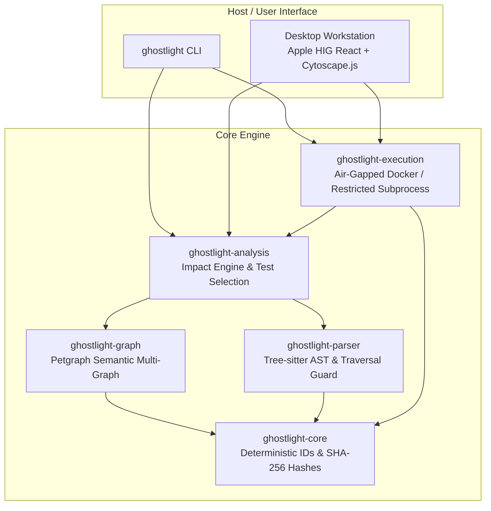

# GHOSTLIGHT

> **Local-First Codebase Intelligence and Change-Impact Analysis System**

GHOSTLIGHT reveals the hidden architecture of software repositories and explains how code changes propagate across modules, symbols, dependencies, and automated test suites.

Built with **Rust**, **Tree-sitter**, **Petgraph**, and a **React + Cytoscape.js** desktop workstation inspired by Apple Human Interface Guidelines and developer pro tools (Xcode, Instruments). 100% offline, zero-telemetry, and strictly sandboxed.

---

## The Problem GhostLight Solves

In medium and large codebases, understanding the blast radius of a change is difficult and error-prone. Developers often:
- Rely on intuition or grep to guess which callers might break.
- Run complete, slow test suites because they cannot pinpoint which tests exercise the changed code.
- Encounter unexpected circular dependencies and regression loops introduced by seemingly local edits.
- Use cloud or LLM-based tools that leak proprietary repository code to external APIs.

GHOSTLIGHT solves this by building an **evidence-backed, deterministic dependency multi-graph** directly from AST syntax trees on your local machine. It calculates direct and transitive impact, ranks affected candidate tests, optionally executes them in an air-gapped sandbox, and reconciles predicted impact with observed test outcomes—all without sending a single byte over the network.

---

## Key Capabilities

- **Evidence-Backed Graph Construction**: Extracts Concrete Syntax Trees via Tree-sitter and builds a semantic multi-graph of files, classes, methods, functions, and imports. Differentiates statically proven facts from heuristic conventions.
- **Explainable Change Impact**: Pinpoints exact direct and transitive ripple effects when a file or symbol is modified, providing multi-hop causal dependency paths with severity tiers.
- **Targeted Test Selection**: Identifies candidate affected tests using call reachability and naming conventions without claiming unverified coverage.
- **Safe Test Execution Sandbox**: Static scanning **never executes repository code**. Authorized test runs execute in air-gapped Docker containers (`--network none`, read-only mounts, non-root user) or restricted subprocesses with process group termination.
- **Outcome Reconciliation**: Directly compares static predictions against observed runtime test outcomes, highlighting genuine regressions.
- **Ultra-Fast Incremental Analysis**: Fingerprints repository states using SHA-256 Merkle trees; re-analyzes modified files in **75 microseconds** (4.7× faster than full rebuilds).
- **Apple HIG-Inspired Workstation**: Xcode-style 3-pane split view with collapsible Navigator source list (`⌘0`), calm graphite canvas (`#121215`), dynamic causal dimming, Spotlight search (`⌘K`), and an Apple Pro Utility Inspector (`⌥⌘0`).

---

## Current Scope & Limitations

- **Language Support**: Currently features deep AST scanning and symbol extraction for **Python** via Tree-sitter. The parser architecture (`ghostlight-parser`) is language-agnostic and designed for future language drivers (e.g., TypeScript, Rust, Go).
- **Test Frameworks**: Automated test execution and discovery currently targets `pytest`. Unrecognized test runners can still be modeled through dependency reachability.
- **Dynamic Language Dynamic Dispatch**: Dynamic metaprogramming (e.g., `getattr()`, runtime `eval()`, dynamic monkey-patching) is noted as untracked dynamic access rather than assumed statically.
- **Sandboxing**: Containerized air-gapped execution requires a local Docker daemon. When Docker is unavailable, GhostLight falls back to restricted subprocess execution with process group isolation and strict timeouts.

---

## Architecture Overview



---

## Installation & Build

### Prerequisites
- Stable Rust `1.85.0+`
- Node.js `22+` with `pnpm`
- Python `3.10+` with `pytest` (optional, for executing local test suites)
- Docker (optional, for air-gapped container test isolation)

### 1. Clone the Repository
```bash
git clone https://github.com/Kai-Kodes/GhostLight.git
cd GhostLight
```

### 2. Build the Rust Engine & CLI
```bash
cargo build --release
```
The compiled executable will be available at `./target/release/ghostlight`.

### 3. Build the Desktop Interface
```bash
cd apps/desktop
pnpm install
pnpm build
cd ../..
```

---

## Running Tests

GhostLight maintains a comprehensive test suite across the backend Rust workspace and frontend desktop application.

### Run Backend Rust Workspace Tests (26 tests)
```bash
cargo test --workspace
```

### Run Frontend Vitest Suite (Contract & Topology tests)
```bash
cd apps/desktop
pnpm test
```

### Run Benchmarks
```bash
cargo bench -p ghostlight-benches
```

---

## CLI Usage

### System Diagnostics
Inspect local environment capabilities, Python/pytest availability, and Docker sandboxing status:
```bash
ghostlight doctor
```

### Scan Repository Inventory & Merkle Fingerprint
```bash
ghostlight scan fixtures/complex-python
ghostlight scan fixtures/complex-python --json
```

### Dependency Graph Export
```bash
ghostlight graph fixtures/complex-python
ghostlight graph fixtures/complex-python --output graph.json
```

### Change-Impact Analysis
```bash
# Calculate blast radius for an entire file
ghostlight impact fixtures/complex-python --file utils/crypto.py

# Calculate blast radius for a specific function or class symbol
ghostlight impact fixtures/complex-python --file utils/crypto.py --symbol hash_password
```

### Targeted Test Verification
```bash
# Predict candidate affected tests without executing code
ghostlight test fixtures/regression-python --file pricing/discount.py --symbol calculate_discount

# Safely execute candidate tests in an air-gapped Docker container or restricted sandbox
ghostlight test fixtures/regression-python --file pricing/discount.py --symbol calculate_discount --execute
```

### Executive Intelligence Report
Generate an exportable Markdown or JSON report:
```bash
ghostlight report fixtures/regression-python --format markdown
```

### Launch Interactive Desktop Workstation
```bash
ghostlight serve --port 1420
```
Open your browser at `http://localhost:1420`.

---

## Performance Benchmarks

Measured on Linux x86_64, release build:

| Metric | Measured Result |
| :--- | :--- |
| **Python AST Extraction Throughput** | `182.3 µs` (~6.36 MiB/s) |
| **Graph Construction (50 modules)** | `357.5 µs` |
| **Change-Impact Analysis (Transitive Closure + Paths)** | `2.31 ms` |
| **Warm Incremental Re-analysis (1 modified file)** | `75.0 µs` (4.7× speedup) |
| **Report Serialization (JSON)** | `1.23 µs` |
| **Report Rendering (Markdown)** | `505 ns` |

Detailed methodology and profiling logs are documented in [`docs/benchmarks.md`](docs/benchmarks.md).

---

## Security Model

- **Zero-Execution Static Scanning**: Tree-sitter parses Concrete Syntax Trees in memory. The target repository's code is never executed during scanning or graph construction.
- **Symlink Escape Defense**: Repository traversal detects and blocks directory symlinks that resolve outside the repository root.
- **Denial-of-Service Guards**: 5 MB per-file size limit, AST traversal depth cap (256), and 1 MB output capture limits prevent resource exhaustion.
- **Air-Gapped Docker Isolation**: Authorized test runs execute with `--network none`, `--read-only` root filesystem, non-root UID, memory caps (512MB), CPU caps (1.0), and strict timeouts.
- **Restricted Subprocess Fallback**: When Docker is unavailable, tests execute in a restricted child process with process group isolation, strict resource limits, and SIGKILL termination.
- **Zero Telemetry**: Fully offline operation with no external analytics, cloud services, or account requirements.

Detailed threat analysis is documented in [`docs/security.md`](docs/security.md).

---

## License

Dual-licensed under either of:
- Apache License, Version 2.0 ([LICENSE-APACHE](http://www.apache.org/licenses/LICENSE-2.0))
- MIT License ([LICENSE-MIT](http://opensource.org/licenses/MIT))

at your option.
