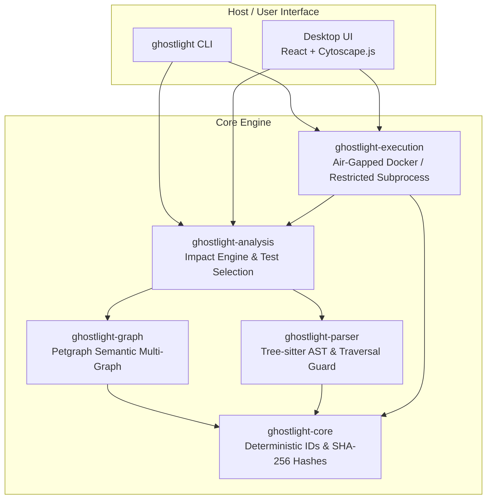

# GHOSTLIGHT

> **Local-First Codebase Intelligence and Change-Impact Analysis System**

GHOSTLIGHT reveals the hidden architecture of software repositories and explains how code edits propagate across modules, symbols, dependencies, and automated test suites.

Built with **Rust**, **Tree-sitter**, **Petgraph**, and **React + Cytoscape.js**. 100% offline, zero-telemetry, and strictly sandboxed.

---

## Key Features

- **Evidence-Backed Graph Construction**: Extracts abstract syntax trees with Tree-sitter and builds a semantic multi-graph of files, classes, methods, functions, and imports. Differentiates statically proven facts from heuristic conventions.
- **Explainable Change Impact**: Pinpoints exact direct and transitive ripple effects when a file or symbol is modified, providing multi-hop causal dependency paths.
- **Intelligent Test Selection**: Heuristically ranks candidate affected tests using call reachability and naming conventions without claiming unverified coverage.
- **Safe Test Execution Sandbox**: Static scanning **never executes repository code**. Authorized test runs execute in air-gapped Docker containers (`--network none`, read-only mounts, non-root user) or restricted subprocesses with process group termination.
- **Outcome Reconciliation**: Directly compares static predictions against observed runtime test outcomes, highlighting genuine regressions.
- **Ultra-Fast Incremental Analysis**: Fingerprints repository states using SHA-256 Merkle trees; re-analyzes modified files in **75 microseconds** (4.7× faster than full rebuilds).
- **Interactive Dark-First Desktop Interface**: Powered by Cytoscape.js with fluid zooming, panning, glowing blast-radius overlays, dependency explorer, and test runner.

---

## Architecture Overview



---

## Installation & Build

### Prerequisites
- Stable Rust `1.85.1+`
- Node.js `22+` with `pnpm`
- Python `3.10+` with `pytest` (optional, for running local tests)
- Docker (optional, for air-gapped container test isolation)

### Building the Binary
```bash
git clone https://github.com/ghostlight-org/ghostlight.git
cd ghostlight
cargo build --release
```

The compiled executable is available at `./target/release/ghostlight`.

### Building the Desktop Frontend
```bash
cd apps/desktop
pnpm install
pnpm build
```

---

## CLI Usage

### System Diagnostics
```bash
ghostlight doctor
```

### Scan Repository Inventory & Fingerprint
```bash
ghostlight scan fixtures/complex-python
ghostlight scan fixtures/complex-python --json
```

### Dependency Graph Export
```bash
ghostlight graph fixtures/complex-python
ghostlight graph fixtures/complex-python --output graph.json
```

### Change-Impact Analysis
```bash
# Calculate blast radius for a file
ghostlight impact fixtures/complex-python --file utils/crypto.py

# Calculate blast radius for a specific symbol
ghostlight impact fixtures/complex-python --file utils/crypto.py --symbol hash_password
```

### Targeted Test Verification
```bash
# Select candidate tests without executing code
ghostlight test fixtures/regression-python --file pricing/discount.py --symbol calculate_discount

# Safely execute candidate tests in Docker container or restricted sandbox
ghostlight test fixtures/regression-python --file pricing/discount.py --symbol calculate_discount --execute
```

### Executive Intelligence Report
```bash
ghostlight report fixtures/regression-python --format markdown
```

### Launch Interactive Desktop UI
```bash
ghostlight serve --port 1420
```
Open your browser at `http://localhost:1420`.

---

## Performance Benchmarks

Measured on Debian GNU/Linux 13 (Trixie), x86_64, release build:

| Metric | Measured Result |
| :--- | :--- |
| **Python AST Extraction Throughput** | `182.3 µs` (~6.36 MiB/s) |
| **Graph Construction (50 modules)** | `357.5 µs` |
| **Change-Impact Analysis (Transitive Closure + Paths)** | `2.31 ms` |
| **Warm Incremental Re-analysis (1 modified file)** | `75.0 µs` (4.7× speedup) |
| **Report Serialization (JSON)** | `1.23 µs` |
| **Report Rendering (Markdown)** | `505 ns` |

Detailed methodology and profiling logs available in [`docs/benchmarks.md`](docs/benchmarks.md).

---

## Security Model

- **Zero-Execution Static Analysis**: Tree-sitter parses Concrete Syntax Trees purely in memory. The Python interpreter is never spawned during scanning or graph analysis.
- **Symlink Escape Defense**: Repository traversal detects and blocks directory symlinks that resolve outside the repository canonical root.
- **Denial-of-Service Guards**: 5 MB file size limit, AST traversal depth cap (256), and 1 MB output capture truncation prevent memory exhaustion.
- **Air-Gapped Docker Isolation**: Test runs execute with `--network none`, `--read-only` root filesystem, non-root UID, memory caps (512MB), CPU caps (1.0), and strict timeouts.
- **Zero Telemetry**: Fully offline operation with no external analytics, cloud services, or account requirements.

Detailed threat model available in [`docs/security.md`](docs/security.md).

---

## License

Dual-licensed under either Apache License, Version 2.0 or MIT license at your option.
