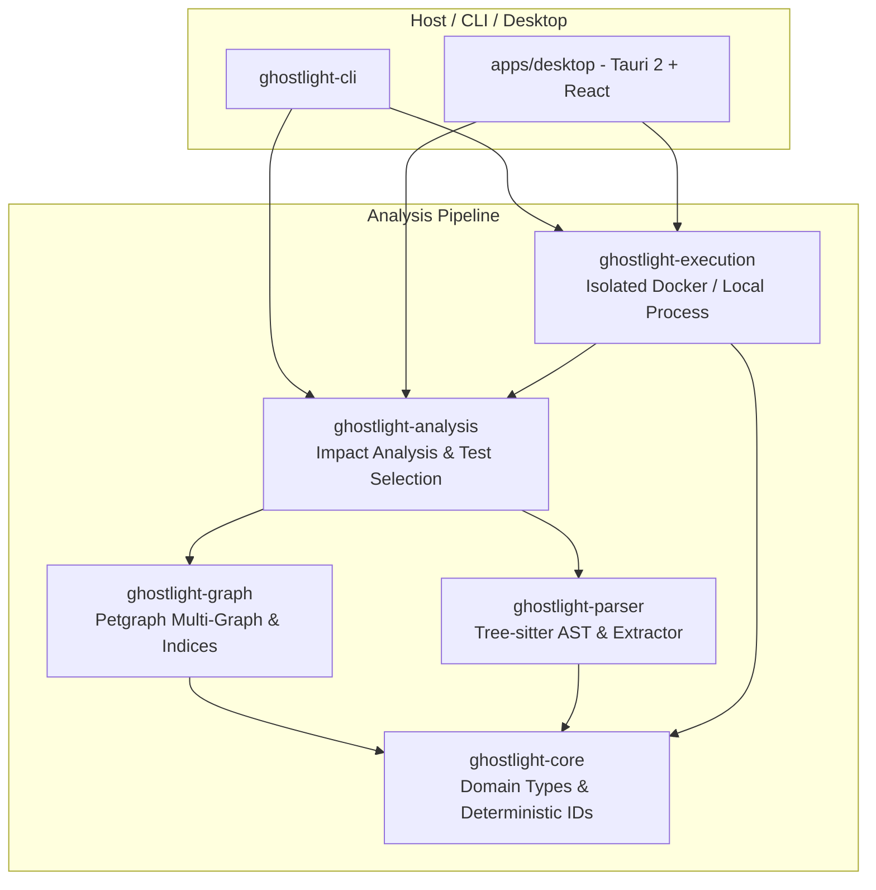

# GHOSTLIGHT: Architecture Decision Record & System Architecture

## 1. Context and Vision

GHOSTLIGHT is a local-first codebase intelligence and change-impact analysis engine. Its mission is to reveal the structural topology of software repositories and explain how code edits propagate across modules, symbols, dependencies, and automated test suites.

Modern software development often suffers from two failure modes:
1. **Blind refactoring**: Modifying a utility, class, or function without knowing the full transitive graph of downstream consumers.
2. **Slow, unguided verification**: Running every single test in a test suite, or guessing which tests matter, leading to delayed feedback loops.

GHOSTLIGHT solves this by building an evidence-backed dependency graph, offering deterministic static impact prediction, identifying candidate tests, and optionally executing those tests in an isolated, safe container.

---

## 2. Core Architectural Principles

1. **Evidence-First Soundness**: Differentiate static-analysis inferences from observed runtime facts. If a call target cannot be statically proven, classify it as `Unresolved` or `Ambiguous` rather than inventing false edges.
2. **Strict Local-First & Zero-Telemetry**: Operates completely offline without external APIs, accounts, cloud dependencies, or telemetry.
3. **Defense-in-Depth for Untrusted Codebases**: Repositories are untrusted inputs. Static analysis never executes repository code. Test execution requires explicit authorization and defaults to isolated Docker containers.
4. **Determinism and Reproducibility**: Graph construction, node IDs, topological traversals, and serialized reports are deterministic and stable across runs.
5. **Decoupled Engine**: The core analysis domain (`ghostlight-core`), parser (`ghostlight-parser`), graph (`ghostlight-graph`), and impact engine (`ghostlight-analysis`) are independent libraries consumable by both the CLI and desktop UI.

---

## 3. Technology Stack Decisions

| Component | Selected Technology | Rationale & Alternatives Considered |
| :--- | :--- | :--- |
| **Language** | Stable Rust 1.85.1 (2021 edition) | Memory safety, zero-cost abstractions, deterministic concurrency, high throughput. Avoids unsafe code. |
| **Parsing** | Tree-sitter `0.22.6` + `tree-sitter-python 0.21.0` | Concrete Syntax Tree (CST) parsing with error-tolerant recovery, fast incremental parsing, source ranges. Verified compatible with Rust 1.85. |
| **Graph Representation** | `petgraph 0.7` Directed Multi-Graph | Industry-standard graph library with indexed adjacency, cycle detection, reachability, shortest paths. |
| **Hashing & Fingerprints** | SHA-256 (`sha2 0.10`) | Cryptographic content hashing for change detection, cache invalidation, and incremental differential analysis. |
| **CLI Framework** | `clap 4.5` (derive) | Clean subcommands (`scan`, `graph`, `impact`, `report`, `doctor`, `test`), auto-generated help, structured argument parsing. |
| **Desktop Shell** | Tauri 2 (Rust native backend) | Lightweight native wrapper with secure IPC, low memory footprint. |
| **Frontend Framework** | React 18 + TypeScript + Vite + pnpm | Modern declarative UI, typed contracts, responsive state management. |
| **Visualization** | Cytoscape.js | High-performance canvas-based network graph rendering with compound nodes, layouts, zooming, and interactive filtering. |
| **Test Execution** | Docker container isolation (fallback: restricted subprocess) | Disables network, non-root user, memory/CPU bounds, timeout termination. |

---

## 4. Subsystem Decomposition

### 4.1. `ghostlight-core`
- **Identifiers**: `NodeId`, `FileId`, `SymbolId`. Fully deterministic based on canonical relative paths and scoped symbol qualifiers (e.g., `file:src/utils.py`, `symbol:src/utils.py::format_date`).
- **Graph Primitives**: `NodeKind` (`File`, `Module`, `Function`, `Method`, `Class`, `Test`), `EdgeType` (`Imports`, `Calls`, `Inherits`, `Defines`, `References`), `Confidence` (`Static`, `Heuristic`, `Uncertain`).
- **Hashing**: SHA-256 per-file hashes and whole-repository Merkle-tree style fingerprint.

### 4.2. `ghostlight-parser`
- Scans files while honoring repository boundaries, symlink recursion prevention, file size limits (default 5MB), and binary file exclusion.
- Extracts Python imports (`import foo`, `from foo.bar import baz, qux as q`), definitions (functions, async functions, classes, methods), inheritance (`class Sub(Base1, Base2):`), calls (`func()`, `obj.method()`), decorators, and pytest test naming conventions (`test_*`, `Test*`).

### 4.3. `ghostlight-graph`
- Dual-indexed directed multi-graph: fast lookup by `NodeId`, by file path, and by symbol name.
- Semantic resolver: maps Python import paths to files and package `__init__.py` modules within the repository.
- Algorithms: Direct dependency traversal, reverse dependency traversal (transitive closure / blast radius), cycle detection, shortest explanatory path via Dijkstra/BFS.

### 4.4. `ghostlight-analysis`
- **Impact Calculation**: Given a modified file or symbol, calculates:
  - *Direct impact*: Immediate dependents calling or importing the modified node.
  - *Transitive impact*: Recursive downstream nodes affected by ripple effects.
  - *Explanatory paths*: Step-by-step causal chain showing how the change reaches each affected entity.
- **Test Selection**: Heuristically ranks candidate tests using dependency paths, test imports, naming patterns, and fixtures.
- **Differential/Incremental Engine**: Compares baseline fingerprint vs modified fingerprint, reparsing only changed/added/deleted files, updating graph incrementally, and validating equivalence with full scans.

### 4.5. `ghostlight-execution`
- Safe test runner: Never executes code without explicit user trigger.
- **Docker Isolation**: Mounts repository read-only or in ephemeral overlay, drops network (`--network none`), runs as unprivileged user, imposes memory limits (e.g. 512MB) and timeout limits (e.g. 60s).
- **Subprocess Isolation**: Where Docker is unavailable, checks security allowlists, executes pytest with restricted parameters, enforces process group termination on timeout, caps stdout/stderr to 1MB.
- **Outcome Reconciliation**: Compares predicted impact vs observed test outcomes (passed, failed, skipped, error).
